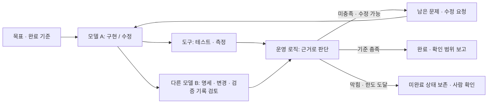

# ACT4 재기획 — 목표 달성까지 구현·검토·수정하기

Date: 2026-10-25. Inspected baseline: `ee0add1`.
Decision: [DEC-0096](DECISIONS.md#dec-0096--recenter-the-act4-planning-brief-on-goal-directed-review-loops).

## 1. 문서의 상태와 이번 작업 범위

**기획안: APPROVED / DEC-0097에 따라 제작 적용.**

이번 사용자의 확정 지시는 다음과 같다.

- 현재 S100의 GPU 사례를 다음 ACT4 구성에서 제외한다.
- ACT4의 중심은 목표를 달성할 때까지 수정과 검토를 반복하는 시스템이다.
- 구현·수정과 검토에 서로 다른 모델을 활용하는 설계와 관련 연구를 설명한다.
- 현재 구성으로 만들어진 원인을 분석하고 ACT4를 다시 기획한다.

이 지시는 이전의 Harness 개선 중심보다 우선하는 **재기획의 기준**이다.
사용자는 이후 이18장·81분 기획의 제작을 승인했다. 실제 모델·목표 수치·실행 검증은 여전히 미확정이다.

기획 당시에는 문서만 작성했다. 이후 제작 승인으로 ACT4/Full PPT, 관련 ACT3·ACT5 연결, Notes·Map·Preview와 번호를 정렬한다. Demo Repository와 새 Trial은 범위 밖이다.

기획 검토 시점의 제작 기준은 **115장 / 406분**, ACT4 **S82–S100 / 19장 / 81분**이었다. 현재 승인 제작은114장·406분, ACT4 S82–S99의18장·81분이다.
계획의 예상 장수와 현재 제작본의 장수를 섞어 보고하지 않는다.

## 2. ACT4가 전달해야 할 핵심

> 목표와 완료 기준을 유지한 채, 구현 결과를 검토하고 남은 문제를 다음
> 수정의 입력으로 되돌려 목표 충족 여부를 다시 판단하는 시스템을 설계한다.

이번 목표가 완료되기 전의 다음 수정이 중심이다. 경험을 다음 작업의 지침에
반영하는 Harness 개선은 관련 확장이지만 이 ACT의 주 사례를 대신하지 않는다.

청중이 답할 수 있어야 할 질문:

1. 무엇을 이루려 하며 어떤 근거로 완료를 판단하는가?
2. 누가 구현하고 누가 검토하며, 검토에는 어떤 자료가 필요한가?
3. 검토에서 발견한 문제가 어떻게 다음 수정에 전달되는가?
4. 수정 후 같은 기준을 다시 확인하는가?
5. 언제 완료하고, 언제 계속하며, 언제 사람에게 판단을 넘기는가?
6. 구현과 검토에 서로 다른 모델을 배치하는 이유와 연구상의 한계는 무엇인가?

### 기본 운영 도식

도구 검증과 모델 검토의 실행 순서는 작업 의존관계에 따라 달라질 수 있다.
위 그림이 병렬 실행의 실측 결과나 특정 제품의 내장 기능을 뜻하지는 않는다.
운영 로직은 완전히 별개의 모델일 필요가 없다. 다음 입력·상태·분기를 정하는
코드나 작업 흐름일 수 있으며, 구체적 실행 표면은 후속 검증 대상으로 둔다.

모델 A와 B가 동의했다는 사실만으로 완료하지 않는다. 테스트·명세·측정 등
독립적으로 확인할 근거와 미해결 검토 항목을 함께 본다. 검토 모델의 잘못된
지적은 확인 후 기각할 수 있으며, 기준 변경이 필요하면 사람이 판단한다.

## 3. 왜 현재 ACT4가 이 방향에서 벗어났는가

### 확인한 경로

| 단계 | 확인한 원문 / 이력 | 구성에 미친 영향 |
|---|---|---|
| 초기 기획 | `930ae8a`의 MASTER_PLAN에 Product Loop와 Harness Improvement Loop가 함께 있고 후자에 더 비중을 두는 문구가 있음. 현행 [§14](MASTER_PLAN.md#14-loop-engineering의-범위와-두-종류의-loop)에도 유지됨 | 한 목표의 수정·검토 반복보다 다음 작업의 환경 개선이 중심으로 선택됨 |
| 구조 규칙 | `55180f2`의 [INV-LOOP-001](INVARIANTS.md#inv-loop-001--use-feedback-to-improve-the-development-system), INV-MATURITY-010 | Harness 노후화가 Loop 도입의 필수 문제로 고정되고 수행 루프는 보조로 밀림 |
| 정의 동결 | [DEC-0023](DECISIONS.md#dec-0023--freeze-step-08-claims-and-course-operational-definitions), CLAIM_FREEZE, TERMINOLOGY | `실행 → 관찰 → 원인 → 시스템 변경 → 재평가`가 ACT4 전체를 대표하는 정의로 굳어짐 |
| Research | [loop-engineering.md](../references/engineering/loop-engineering.md), CLAIMS, SOURCES | Self-Refine/Reflexion은 배경에 있고, 서로 다른 모델의 검토 효과를 주장·Slide로 연결한 항목은 확인되지 않음 |
| 사례 선택 | DEMO-04A와 DEMO-04B, 현행 S84–S99 | 가상 지침 갱신과 실제 평가·보고 기준 변경이 대부분을 차지함. 같은 목표의 반복 구현·검토 기록은 중심 사례가 되지 못함 |
| 직전 보완 | `ecdd57b`, [DEC-0094](DECISIONS.md#dec-0094--clarify-act4-loop-boundaries-and-evaluation-driven-control), [ACT4_LOOP_CONTROL](ACT4_LOOP_CONTROL.md) | 두 루프와 완료·재시도·중단 분기를 추가했지만, 기존 구성 보존 안에서 체계 개선 중심을 유지함 |

초기 사용자 제공 원문에도 두 Loop와 Harness Improvement Loop의 우선 비중이
있었다. 따라서 모든 방향을 제작 과정에서 새로 만들어 넣었다고 설명할 수는
없다. 다만 그 문구를 현재 사용자가 명확히 설명한 목표보다 앞세울 수는 없다.

### 제작·검토상의 원인

1. **부분 주제를 전체 정의로 확대했다.** Harness 개선에 대한 비중이 커지며
   원문에 함께 있던 `Code → Test → Fix → Test`가 실제 교육의 중심에서 빠졌다.
2. **문서 간 일치를 학습 의도 검증으로 대신했다.** Master, Invariant, Claim,
   Map, Notes가 서로 일치하는지는 확인했지만, 청중이 목표 기반 반복 시스템을
   실제로 이해할 수 있는지는 별도 기준으로 충분히 확인하지 않았다.
3. **연구 요구의 추적 연결이 없었다.** 반복 개선의 근거와 서로 다른 모델의
   검토 효과를 분리해 Research → Claim → 사례 → Slide로 연결하지 않았다.
4. **보유 근거에 이야기를 맞췄다.** 실제 Meta 기록은 보고 기준 변경을 설명할
   수 있지만, 구현 모델과 검토 모델이 같은 목표를 두고 반복한 결과의 근거는
   아니다. 이 차이를 보존하는 데서 그치고 필요한 중심 사례를 설계하지 않았다.
5. **국소 수정이 잘못된 중심을 유지했다.** 최근 보완도 S94에 판단 분기를
   더하는 방식이었다. 핵심 질문·주 사례·연구 연결부터 재설계해야 했다.

이는 화면에 순환 화살표 하나를 추가해 해결할 문제가 아니다. ACT4의 중심 질문,
사례의 개선 대상, 피드백의 도착점, 완료 판정을 함께 바꿔야 한다.

## 4. ACT3 → ACT4 → ACT5 연결

### ACT3에서 가져올 것

Harness의 재사용 장점과 실제 밝기 통계 작업의 한정된 성공은 유지한다.
기존 외부 지침·권한·설정 관찰도 실제 근거의 범위를 바꾸지 않는다.

ACT3 후반 S77–S81은 제작 시 연결을 다시 확인할 대상이다. 새 연결의 질문은:

> 작업 방법을 재사용할 수 있게 했습니다. 그런데 목표가 아직 충족되지 않았을
> 때마다 사람이 “이 부분을 검토하고, 고치고, 다시 확인해 달라”고 이어줘야 한다면?

사람이 하던 반복 보정 중 **이번 목표에 대한 검토 → 수정 → 재검토 연결**을
시스템에 담을 필요를 보여준다. 실제 Demo에서 이런 실패가 관찰됐다는 주장은
하지 않는다. Harness를 쓰면 원래 피드백이 없다는 정의도 추가하지 않는다.

### ACT4의 문제와 해결

- 문제: 한 번의 실행 이후 남은 문제를 사람이 다시 요청으로 연결해야 한다.
- 해결: 목표·완료 기준, 구현/검토 역할, 도구 근거, 피드백 전달, 다음 행동의
  분기를 갖춘 작업 수행 루프를 설계한다.
- 발전: 구현과 검토를 다른 모델에 맡기는 구성을 연구와 연결해 검토한다.
- 판단: 반복 횟수 증가와 실제 목표 충족을 구분한다.

### ACT5로 넘길 것

> 요청·Context·수행 방법·검증·반복 판단을 내 업무에 맞게 조합하되,
> 필요 없는 단계와 역할은 줄일 수 있습니다.

기존 ACT5의 조합·통합·제거 흐름을 유지한다. ACT4의 결론을 “모델과 규칙을
계속 추가하자”로 만들지 않는다. ACT5의 실제 제품 이력은 바꾸지 않고,
Loop를 회수하는 정의와 앞뒤 전환만 정렬한다.

## 5. 중심 사례 — 한 목표의 연속된 수정·검토

### 작업과 완료 기준

같은 교육용 프로젝트의 **밝기 통계 작업**을 사용한다. 기존 함수명·출력 명세는
실제 자료를 참고하되 아래 반복 이력은 **새로운 교육용 설계**로 구분한다.

목표 후보:

> 밝기 통계의 출력·동작을 유지하면서 불필요한 임시 할당을 줄이고,
> 정한 실행시간 조건도 만족하도록 개선한다.

처음부터 제시하고 반복 중 임의로 낮추지 않을 기준:

- 기존 6개 출력 `width`, `height`, `pixel_count`, `minimum`, `maximum`,
  `mean`과 명세 보존.
- 같은 대표 입력·환경·측정 조건에서 동작 확인 및 할당량·실행시간 평가.
- 남은 중요 검토 지적과 확인하지 못한 사항의 명시.
- 할당량 목표와 실행시간 허용 범위의 수치는 **TBD**. 실행 사례를 만들기 전에
  기준을 확정한다. 과거 벤치마크 값을 새 반복의 완료 기준이나 결과로 사용하지 않는다.

### 화면에 보여줄 진행

1. 목표·완료 기준을 고정하고 모델 A가 첫 후보를 만든다.
2. 테스트·측정 기록과 변경 내용을 모델 B에게 전달한다.
3. B가 위치·위반 기준·근거·수정 요청을 구체적으로 남긴다.
4. A가 지적을 확인해 필요한 변경과 추가 검증을 수행한다.
5. B와 도구가 새 후보를 같은 기준으로 다시 확인한다.
6. 남은 문제가 있으면 다음 수정으로 돌아간다. 충족 시 완료하고, 막히거나
   한도에 도달하면 미완료 상태와 판단할 질문을 사람에게 전달한다.

매번 같은 목표 카드와 후보 버전 `v1 → v2 → v3`를 이어 쓴다. 검토 지적이
다음 변경의 어느 부분으로 이어졌는지 동일한 번호로 연결한다. 각 장에 새
사례를 넣거나 한 장에 모든 이력을 펼쳐 놓지 않는다.

예시 검토 항목은 명세 보존 누락이나 확인 자료 부족으로 설계할 수 있다.
그러나 실제 코드에서 발생한 결함으로 단정하지 않으며, 설계 화면에는
`교육용 진행 예 / 실제 실행 결과 아님`을 표시한다. 실행하지 않은 PASS,
FAIL, 성능 수치, 로그 화면은 만들지 않는다.

### 실제 시연으로 발전시키는 조건

중심 사례를 OBSERVED로 제작하려면 별도 실행 검증이 필요하다. 고정된 목표와
기준, 실제 모델 식별 정보, 모델에 제공한 입력, 수정 diff, 검토 의견, 실제
검사 결과, 다음 행동 판단을 최소 두 순환 이상 보존하는 안을 권장한다.
같은 모델의 여러 인스턴스인지 서로 다른 모델인지도 명시한다.

새 Trial 실행과 Demo Repository 변경은 이번 작업에 포함하지 않는다.
실제 실행이 준비되지 않은 동안은 설계 사례로 제시하고, 기존 TRIAL-008을
다중 모델 반복 실행의 증거로 재해석하지 않는다.

## 6. Slide 구성 초안

**승인한18장 / 81분의 제작 기준**이다. 현재 S100을 제거하고 S82–S99를
재설계하는 안이다. 번호는 비교 편의를 위한 예정 번호이며 현행 Map은 그대로다.
장별 시간은 아래를 유지하고 Mode/Template는 현행 SLIDE_MAP/SLIDE_TEMPLATE_MAP에 확정했다. ACT4 Mode는 Lecture30/Case37/Reflection4/Q&A7/Transition3이다.

| 예정 ID | 시간 | Working Title / 한 장의 역할 | 중심 시각 자료 / 근거 종류 |
|---|---:|---|---|
| S82 | 1분 | 목표를 이룰 때까지 수정하고 검토하기 — ACT 제목 | 제목·부제. TEACHING_MODEL |
| S83 | 4분 | 다음 수정도 사람이 매번 이어줘야 할까? | 같은 목표에서 검토·수정을 사람이 반복 요청하는 흐름. 교육용 문제 설정 |
| S84 | 4분 | 먼저, 무엇이 되면 완료인지 정한다 | 밝기 통계 목표와 고정된 완료 기준 카드. 명세 참고 + 설계 |
| S85 | 4분 | 모델 A가 첫 변경 후보를 만든다 | 목표 → 후보 v1. 변경 내용과 아직 확인할 사항 구분. 설계 |
| S86 | 5분 | 실제 동작과 비용은 도구로 확인한다 | 후보 → 테스트·할당량·실행시간 확인 항목. 결과 수치는 미실행이면 없음 |
| S87 | 5분 | 모델 B는 무엇을 근거로 검토할까? | 다른 모델 B에 명세·diff·검사 기록 전달 → 위치·근거 있는 지적. 설계 |
| S88 | 4분 | 지적이 다음 수정으로 이어진다 | 지적 ① ↔ 수정 ①, 후보 v1 → v2. 지적 수용·기각 근거 구분 |
| S89 | 4분 | 고쳤다면, 같은 기준으로 다시 본다 | v2 → 같은 검사·재검토 → 남은 항목. 기준을 낮춰 완료하지 않음 |
| S90 | 5분 | 이 연결이 하나의 작업 수행 루프다 | 목표 / 구현 A / 도구 / 검토 B / 피드백이 닫히는 전체 도식 |
| S91 | 5분 | 언제 계속하고, 언제 끝낼까? | 완료 / 수정 계속 / 막힘·한도 후 사람 확인. 미완료 중단과 완료 구분 |
| S92 | 4분 | 구현한 모델에게 다시 물으면 충분할까? | 자기 피드백과 외부 근거의 차이. Self-Refine 및 자기 교정 한계 연구 |
| S93 | 5분 | 다른 모델의 관점이 도움이 된 실험 | ReConcile의 동일 모델 구성과 여러 모델 구성 비교. RESEARCH |
| S94 | 4분 | 잘 만드는 능력과 잘 검토하는 능력 | CriticBench의 생성·검토·수정 능력 및 모델 조합 차이. RESEARCH |
| S95 | 4분 | 구현과 검토에 모델을 어떻게 나눌까? | 같은 모델 역할 분리 / 다른 모델 조합을 구분한 운영 설계. 연구에서 도출한 제안 |
| S96 | 4분 | 검토 모델의 말도 확인해야 한다 | 지적 → 명세·테스트 대조 → 수용·기각·사람 확인. 동의만으로 완료 금지 |
| S97 | 4분 | 반복하려면 무엇을 이어받아야 할까? | 목표·후보·지적·검사·남은 문제·한도를 가진 최소 상태. 별도 Memory 강제 없음 |
| S98 | 4분 | 이 교육에서 확인한 것과 아직 실행하지 않은 것 | 기존 실제 Trial / 연구 결과 / 설계 루프의 세 경계. 새 다중 모델 성과 주장 없음 |
| S99 | 11분 | 우리 작업에는 어떤 루프가 필요할까? | 한 목표·검토 기준·역할을 고르는 성찰과 Q&A, ACT5의 조합·통합·제거로 전환 |
| 합계 | **81분** | **18장** | 장별 시간 확정 / Mode는 현행 Map |

설명용 순환은 S84–S89에서 단계별로 본 뒤 S90에서 전체 그림을 회수한다.
이후 연구와 운영 판단을 연결한다. 연구부터 소개하고 나중에 문제를 붙이는
순서로 만들지 않는다.

예상 제작 영향은 **114장 / 406분**이다. ACT4 장수가 19→18이 되고 시간은
81분을 유지하는 안이므로 그렇다. ACT5의 이전 S101–S115를 현재 S100–S114로 옮긴다. 현재 제작 목표는114장 /406분이다. 전체 Mode는 Lecture172/Demo51/Case103/Reflection22/Transition26/Q&A32로 정렬한다. 과거 Mode 합계를 그대로 유지했다는 주장은 하지 않는다.

## 7. 연구 근거와 말할 수 있는 범위

확인일: 2026-10-25. 다음은 연구 원문에서 확인한 결과이며 제품 기능 설명과
구분한다. 2023–2024년 모델·벤치마크 결과를 현재 모델의 보편 법칙으로 쓰지 않는다.

| 자료 | 확인한 내용 | ACT4에서 사용할 주장 | 확장하지 않을 주장 |
|---|---|---|---|
| [Self-Refine](https://arxiv.org/abs/2303.17651) | 같은 LLM이 생성·피드백·수정을 반복하는 방법을 여러 과제에서 평가 | 반복 피드백과 수정의 기본 구조를 설명 | 다른 모델 사용의 우월성을 입증했다는 주장 |
| [Large Language Models Cannot Self-Correct Reasoning Yet](https://arxiv.org/abs/2310.01798) | 연구 대상 추론 과제에서 외부 피드백 없는 자기 교정이 어려웠고 악화 사례도 보고 | “다시 검토해”만 반복하는 것과 근거 있는 피드백을 구분 | 현재 모든 모델이 자기 검토에 실패한다는 주장 |
| [ReConcile, ACL 2024](https://aclanthology.org/2024.acl-long.381/), [Table 7 원문](https://aclanthology.org/2024.acl-long.381.pdf) | StrategyQA의 해당 토론·합의 방식에서 여러 모델 구성 79.0±1.6, 세 Agent 모두 ChatGPT인 구성 72.2±2.1. 차이는 6.8 percentage points | 연구된 조건에서 서로 다른 모델 조합이 동일 모델 구성보다 유리한 결과가 있었다 | 현재 Codex 코드 수정에서도 6.8% 개선, 비용 절감, 모든 이종 조합의 우월성 |
| [CriticBench, Findings of ACL 2024](https://aclanthology.org/2024.findings-acl.91/), [§4.2.5 원문](https://aclanthology.org/2024.findings-acl.91.pdf) | 17개 모델의 생성·검토·수정 능력을 평가. 일부 다른 모델의 검토가 대상 모델의 자기 검토보다 나은 경우를 보고 | 생성과 검토 능력·모델 조합을 따로 평가할 이유가 있다 | 약한 모델은 언제나 더 좋은 검토자, 이 교육의 개발 루프 성능이 입증됐다는 주장 |

ReConcile은 여러 모델의 토론·합의 연구이며 Repository 코드 수정 루프의
직접 실험이 아니다. 모델 구성의 변경에는 모델별 능력 차이도 포함된다.
이를 “다른 모델이면 언제나 편향이 독립적이고 더 정확하다”로 단순화하지 않는다.

CriticBench의 교차 모델 검토 결과도 전체 개발 루프의 완료율·비용 개선과는
다르다. 이번 사례에서 제안하는 A/B 역할 배치는 이러한 결과를 참고한
**설계 제안**이고, 실제 조합의 효과는 별도로 평가해야 한다.

슬라이드의 권장 문장:

> 구현과 검토를 다른 모델에 맡겨 관점을 나누는 방법을 고려할 수 있다.
> 연구에서도 도움이 된 조합이 있었으며, 실제 효과는 작업·모델·검증 기준에
> 따라 확인해야 한다.

기존 Research registry에는 새 연구·주장 연결을 후속 제작 시 등록한다.
이 문서에서 가짜 SRC / CLM / Trial ID를 만들거나 기존 ID의 의미를 바꾸지 않는다.
사용자가 과거에 염두에 둔 특정 논문과 이번에 확인한 논문이 같은지는 미확정이다.

## 8. 기존 자료의 처리

| 현재 자료 | 재기획에서의 처리 |
|---|---|
| S100 GPU 사례 | 사용자 지시에 따라 새 ACT4에서 제외. 과거 제작·평가 이력은 보존 |
| S84–S94 가상 stale Workflow / 지침 갱신 | 중심 사례에서 교체. 기존 설계와 근거 기록은 참고 자료로 보존 |
| S95–S99 실제 보고·평가 기준 변경 | 실제 Meta 관찰의 범위를 유지. 연구 또는 반복 구현·검토의 성과로 바꾸지 않음. 상세 설명은 보조 자료로 분리하는 안 |
| STATE-04-PERF와 TRIAL-001–008 | 사실·측정 범위 유지. 새 루프 실행 이력으로 재명명하지 않음 |
| DEMO-04A / DEMO-04B / 기존 EVAL ID | 기존 의미를 유지. 새 사례의 관찰 근거로 재사용하지 않음 |
| Harness 개선 관점 | 관계를 짧게 설명할 수 있지만 ACT4의 주 사례·완료 기준을 대체하지 않음 |

## 9. 제작 단계에서 정렬할 문서

제작 승인에 따라 아래 문서를 같은 의미 변경으로 연결해 정렬한다.

| 영역 | 대상과 확인할 변경 |
|---|---|
| 기획 정의 | MASTER_PLAN §§5.9, 14, INVARIANTS의 INV-LOOP-001 / INV-MATURITY-010. 목표 기반 수행 루프를 중심에 두고 Harness 노후화를 필수 진입 원인으로 강제하지 않음 |
| 정의·주장 | DEC-0023의 적용 범위, CLAIM_FREEZE, TERMINOLOGY, CLM-0021 및 새 Research 연결. 과거 결정 기록을 삭제하지 않고 대체 범위를 기록 |
| 교육 흐름 | CURRICULUM, CURRICULUM_MATRIX, STORY_ARCHITECTURE, STORY_BEATS, TRANSITIONS. ACT3 말미와 ACT5 회수의 정의·질문 정렬 |
| 사례 운영 | DEMO_ARCHITECTURE, DEMO_MATRIX, DEMO_RUNBOOK_SPEC. 설계 사례와 실제 실행 Trial의 상태 구분 |
| Slide / Notes | SLIDE_MAP, SLIDE_TEMPLATE_MAP, Notes Architecture/Freeze 및 ACT3·ACT4·ACT5/Full Notes. 새 장 역할·예정 ID·시간·Mode 대응 |
| 제작물 | ACT4/Full PPT, 필요한 ACT3/5 연결 화면, 번호·하단 팁 참조·Preview·평가. 기존 이미지와 실제 Evidence를 임의로 폐기하지 않음 |

S100 제외와 ACT5 번호 이행표를 작성하고 모든 내부 참조를 함께 검사한다.
다른 ACT의 실제 내용과 승인된 팁 본문은 근거 없이 바꾸지 않는다.

## 10. 제작 승인 후의 확인 기준

- 한 목표·완료 기준이 여러 차례의 구현·검토에 걸쳐 유지된다.
- 검토 지적 → 다음 변경 → 같은 기준의 재검증을 화면만으로 따라갈 수 있다.
- 검토 모델과 구현 모델의 역할, 다른 모델을 쓴다는 의미가 구분된다.
- 모델 의견과 테스트·실측 결과가 서로 다른 근거로 표시된다.
- 완료 / 수정 계속 / 미완료 중단·사람 확인이 명확하다.
- 한도·반복 정체·회귀에 대한 처리가 있고, 미완료를 성공으로 표시하지 않는다.
- 연구의 과제·모델·조건과 현재 교육 사례의 근거가 구분된다.
- 실제로 실행하지 않은 루프·재검토·성과는 설계 상태로 표시한다.
- ACT3의 Harness 재사용과 ACT5의 조합·통합·제거를 이어 준다.
- Notes는 화면의 역할·확인 근거·진행 순서와 일치한다.
- 실제 제작 뒤 전체 렌더링·번호·시간·Mode를 검증한다. 이번 기획 검토를
  렌더링 완료나 실행·리허설 검증으로 보고하지 않는다.

## 11. 남은 결정과 다음 단계

- **구성 검토:** 18장 /81분과 중심 사례의 제작은 승인됐다. 필요한 경우 내용을
  더 나누되 사용자가 허용한 최대 12시간 범위 안에서 명시적으로 계획한다.
- **사례 기준:** 할당량·실행시간 목표 수치와 대표 입력 선정은 TBD.
- **모델·환경:** 구현/검토 모델, 실행 방식, 교육 계정 사용 가능 여부는 TBD.
- **실제 근거:** 다중 모델 반복 실행 기록은 아직 없음. 새 실행 검증의 범위는
  별도로 정한 뒤 진행한다. 기존 Demo 저장소와 State는 이번에 건드리지 않는다.
- **검증 Gate:** Windows PowerPoint, 교육장, 제품·계정, 실제 리허설은
  UNVERIFIED를 유지한다.

다음 단계는 이 기획을 검토한 뒤 정의·흐름·사례·Slide Map을 함께 정렬하는
것이다. 단일 화면만 먼저 고쳐 기존 정의로 되돌아가는 작업 순서는 피한다.

## 제작 적용 — DEC-0097

현행114장·406분과18장·81분 배분은 SLIDE_MAP을 따른다. 새 BEAT-072–083,
Section4R1–4R6, CASE-LOOP-01, SRC-0237–0239와 CLM-0043–0045를 연결한다.
과거 Beat/Demo/Trial/State의 의미를 바꾸지 않는다. 실제 결과·렌더·Notes 대조는
[제작 검토](../production/evaluation/ACT_4_GOAL_LOOP_REVISION.md)에 별도로 기록한다.
