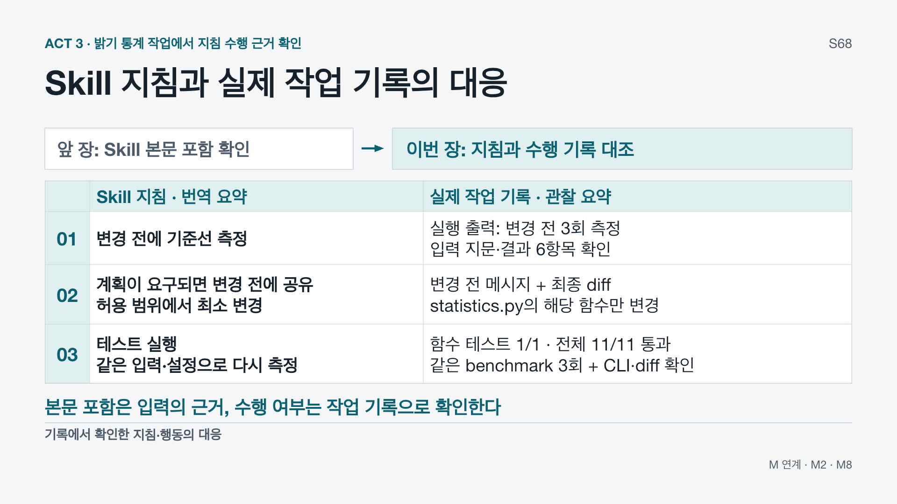

# Skill 지침과 실제 작업 기록의 대응 — 보존 참고 자료

## 현재 판본 안내 — DEC-0132

현재119장·405분의 S67은 Skill 제작 팁이다. 이전121장판 S67·S76은 본편과 활성 Notes에서 삭제했으며 그 내용을 인접 장이나 이 문서에 새로 옮기지 않았다. 아래는 DEC-0131에서 이미 보존한 이전122장판 S68의 이력이다. 아래의 S67 보충 Notes·현재121장판이라는 표현도 당시 판본의 안내이며 현재 운영 순서가 아니다. 현재 순서는 [Slide Map](../../plan/SLIDE_MAP.md)과 [ACT3 Notes](../../production/notes/ACT_3_NOTES.md)를 따른다.

## 보존된 DEC-0131 참고 기록

Decision: DEC-0131. Date:2026-11-02. Baseline:`fa4e41f`.

이 자료는 이전122장판 S68의 상세 대응표와 근거를 보존한다. 현재121장판 S68은 Skill 제작 팁이므로 서로 다른 장이다. 이전 S68은 본편에서 삭제하며 당시 Demo3분+Case3분은 현재 교육시간에 포함하지 않는다. 이 참고 자료는 S67의 보충 근거이며 추가 발표 단계·실습·새 Trial이 아니다.

## 상세 대응표 — 이전122장판 S68

다음 표는 당시 통합 PPT의 native table에서 추출했다. 각 셀의 문구·관찰 횟수·조건·검증 범위를 유지하며 셀 안 줄바꿈만 `<br>`로 표시했다.

|  | Skill 지침 · 번역 요약 | 실제 작업 기록 · 관찰 요약 |
|---|---|---|
| 01 | 변경 전에 기준선 측정 | 실행 출력: 변경 전 3회 측정<br>입력 지문·결과 6항목 확인 |
| 02 | 계획이 요구되면 변경 전에 공유<br>허용 범위에서 최소 변경 | 변경 전 메시지 + 최종 diff<br>statistics.py의 해당 함수만 변경 |
| 03 | 테스트 실행<br>같은 입력·설정으로 다시 측정 | 함수 테스트 1/1 · 전체 11/11 통과<br>같은 benchmark 3회 + CLI·diff 확인 |

## 보존 근거

plan/DEMO_MATRIX.md의 TRIAL-008 Baseline, Plan, Implementation, Verification 및 Prompt Responsibility Shift; STATE-04의 .agents/skills/graypipe-performance/SKILL.md; DEC-0017; BEAT-021. 보존 세션01a0f22c-e6a8-7e50-a4e1-4a581d62266c의20행 요청,22행 전체Skill본문,53/59행 기준선 명령·출력,80행 변경 전 메시지,81행 patch,90/96행 동일benchmark재실행·함수테스트,104/109행 전체테스트·CLI·최종diff를 대조했다. 원문 계획 지침은 “State a concise plan before making edits when the task or working interface calls for a visible plan.”이다. 원문 검증에는 같은 입력·설정·correctness guards, 관련 smoke 확인, diff검토가 포함된다. 실제 측정 명령은 PYTHONPATH=src python3 benchmarks/benchmark_statistics.py이며, 테스트 명령은 PYTHONPATH=src python3 -m unittest discover -s tests -p 'test_statistics.py' -v 및 PYTHONPATH=src python3 -m unittest discover -s tests -v이다.

보존된 상세 출처: TRIAL-008 · Codex CLI 0.154.0 · Skill 번역 요약 + 작업 기록 재구성 (실제 캡처 아님)

## 해석의 한계

OBSERVED_PRODUCT / FROZEN WITH SCOPE / REQUIRES PRODUCT CHECK를 유지한다. Codex CLI0.154.0의 성공한 TRIAL-008 기록이며 현재 Desktop 재현 결과가 아니다. 한글은 원문 지침·작업 기록의 번역 요약이고 실제 UI·로그 캡처가 아니다. 3회는 관찰된 횟수,1/1·11/11은 이 Trial의 테스트 결과다. 전체 지침 준수·Skill 단독 인과성·Prompt 대비 우월성·토큰 절감·Skill에 의한 속도 향상을 주장하지 않는다. Global Harness의 동시 영향은 배제하지 않았다. 새 Trial이나 실행 검증은 하지 않았다.

보존된 상세 범위: 관찰된 대응 · 전체 지침 준수·Skill 단독 인과성·우월성·토큰/속도 효과는 입증하지 않음

세 행은 기록된 지침·행동의 대응이다. 본문 포함, 실제 수행, 전체 지침 준수, 단독 인과성·효과를 구분한다. 현재 제품 가용성이나 현재 교육 계정에서 재현한 결과로 확대하지 않는다.

## 당시 재구성 화면



이 이미지는 당시 PPT 렌더의 정확한 복사이며 실제 실행 UI/터미널 캡처가 아니다. SHA-256:`c95a7a4c298126e5665559766dd9251e0200471ff1a27cd64bb3368ec5a1e120`. 현재 본편의 S68 화면으로 사용하지 않는다.

## 이전122장판 S68 Notes 전문 — 원문 보존

아래 Slide ID·6분 배정·경로는 당시 판본의 이력이며 현재 발표 순서나 파일 경로가 아니다.

```markdown
## S68 — Skill 지침과 실제 작업 기록의 대응

Slide ID:
S68

Working Title: Skill 지침과 실제 작업 기록의 대응

ACT / Section: ACT 3 / 3C

Allocated Time: 6 minutes

Mode Split: Demo 3 minutes (HYBRID planned; activation unverified) + Case 3 minutes

Primary Message: Skill 본문이 들어온 사실은 입력의 근거다. 실제 수행은 같은 작업의 실행 출력, 변경 전 메시지, 최종 diff를 지침과 대조해서 확인한다. 이 사례에서 관찰한 세 가지 대응으로 Skill 전체 준수나 단독 효과를 단정하지 않는다.

Opening Question: “Skill의 전체 본문이 포함됐다는 것만으로, 실제로 그 지침을 수행했다고 말할 수 있을까요?”

Speaker Flow:
1. (0:00–0:30, Demo) 상단 왼쪽에서 S67의 본문 포함 확인을 회수한다. 오른쪽과 표로 이동해 이번에는 밝기 통계 작업의 수행 기록을 보겠다고 안내한다. 화면은 원문 실행 캡처가 아닌 지침 번역·기록 요약이다.
2. (0:30–1:15, Demo) 01행: 왼쪽의 변경 전 기준선 측정 지침과 오른쪽의 실제 실행 출력을 짝짓는다. 수정 전 같은 benchmark 명령을3회 실행했고, 입력 지문과 결과6항목을 확인했다. 3회는 기록된 실행 횟수이며 Skill이 정한 고정 횟수는 아니다.
3. (1:15–2:00, Demo) 02행: 원문은 작업 또는 인터페이스가 visible plan을 요구할 때 변경 전에 간결한 계획을 공유하라는 조건부 지침이다. 이번 기록에서는 변경 전 진행 메시지가 statistics.py의 변경 범위를 밝혔고, 최종 diff에서 해당 함수 한 곳의 변경을 확인했다. 메시지만으로 변경 범위까지 검증했다고 말하지 않는다.
4. (2:00–3:00, Demo) 03행: 테스트와 같은 입력·설정으로 재측정하라는 지침을 실행 결과와 대조한다. 해당 함수 테스트1/1, 전체 테스트11/11 통과와 같은 benchmark의변경 후3회 실행, CLI 샘플·diff 확인을 짚는다. 모델의 최종 완료 보고만이 아니라 보존된 실행 출력에 근거한다.
5. (3:00–4:30, Case) “본문이 들어왔다”와 “지침에 대응하는 작업 기록이 있다”를 구분해 회수한다. 표는 선택한 세 가지 대응이다. 모든 지침 준수나 Skill만의 효과를 검증한 실험은 아니다. 실제 요청에는 이번 목표·결과6항목 보존·허용 범위·trade-off 보고·근거가 부족하면 no-change라는 조건이 남아 있었다.
6. (4:30–6:00, Case) 재사용할 수행 방법을 Skill에 두고 이번 목표·범위는 요청으로 전달한 역할 분담을 정리한다. 다음 S70에서 반복할 절차와 작업마다 근거로 판단할 답을 나눈다. 후보별 수치·선택 결과나 STATE-04-PERF의 성능 비교는 앞당기지 않는다.

Evidence / Source: plan/DEMO_MATRIX.md의 TRIAL-008 Baseline, Plan, Implementation, Verification 및 Prompt Responsibility Shift; STATE-04의 .agents/skills/graypipe-performance/SKILL.md; DEC-0017; BEAT-021. 보존 세션01a0f22c-e6a8-7e50-a4e1-4a581d62266c의20행 요청,22행 전체Skill본문,53/59행 기준선 명령·출력,80행 변경 전 메시지,81행 patch,90/96행 동일benchmark재실행·함수테스트,104/109행 전체테스트·CLI·최종diff를 대조했다. 원문 계획 지침은 “State a concise plan before making edits when the task or working interface calls for a visible plan.”이다. 원문 검증에는 같은 입력·설정·correctness guards, 관련 smoke 확인, diff검토가 포함된다. 실제 측정 명령은 PYTHONPATH=src python3 benchmarks/benchmark_statistics.py이며, 테스트 명령은 PYTHONPATH=src python3 -m unittest discover -s tests -p 'test_statistics.py' -v 및 PYTHONPATH=src python3 -m unittest discover -s tests -v이다.

보존된 상세 출처: TRIAL-008 · Codex CLI 0.154.0 · Skill 번역 요약 + 작업 기록 재구성 (실제 캡처 아님)

Claim Boundary: OBSERVED_PRODUCT / FROZEN WITH SCOPE / REQUIRES PRODUCT CHECK를 유지한다. Codex CLI0.154.0의 성공한 TRIAL-008 기록이며 현재 Desktop 재현 결과가 아니다. 한글은 원문 지침·작업 기록의 번역 요약이고 실제 UI·로그 캡처가 아니다. 3회는 관찰된 횟수,1/1·11/11은 이 Trial의 테스트 결과다. 전체 지침 준수·Skill 단독 인과성·Prompt 대비 우월성·토큰 절감·Skill에 의한 속도 향상을 주장하지 않는다. Global Harness의 동시 영향은 배제하지 않았다. 새 Trial이나 실행 검증은 하지 않았다.

보존된 상세 범위: 관찰된 대응 · 전체 지침 준수·Skill 단독 인과성·우월성·토큰/속도 효과는 입증하지 않음

Beginner Explanation: 지침을 받았다는 것은 요청서가 전달됐다는 뜻이다. 실제로 수행했는지는 측정 출력, 변경 전 설명, 변경 내용과 테스트 결과 같은 작업 흔적에서 확인한다.

Advanced Insight: 입력에 포함된 지침과 관찰된 행동을 구분한다. 실행 출력은 실행·검증의 근거이고, 변경 전 메시지는 계획의 시점, 최종 diff는 변경 범위의 근거다. 세 근거의 대응은 실험 조건을 분리한 인과성 검증과 다르다. Skill이 임의의3회·11개테스트를 고정 요구한 것처럼 설명하지 않는다.

C++ Vision Bridge: N/A.

Demo Operation:
LOCAL STATIC RECORD — S67의 본문 포함 확인에서 진입한다. 표를01→02→03 순으로 읽으며 왼쪽 지침과 오른쪽 근거를 한 행씩 가리킨다. 원문 전체·도구를 실행하지 않는다. Demo3분이 끝나면 같은 화면에서 Case3분으로 전환해 입력/수행 근거를 구분한다. 실제 구현 후보와 성능 비교는 S71–S72로 넘긴다.

Audience Interaction: “변경 전에 하겠다고 말한 기록과, 실제로 바꾼 내용을 확인하는 근거가 같을까요?”를 던지고02행의 메시지·diff를 각각 가리킨다. 답변을 기다리며 별도 실습·Q&A 시간을 추가하지 않는다.

**Transition:**
“지침과 실제 작업 기록을 대응했습니다. 우리 절차도 Codex와 대화하며 Skill로 만들 수 있는지 짧게 보겠습니다.” S69 팁 뒤 S70에서 절차와 작업별 답의 경계를 회수한다.

Time Management:
Demo3분(본문 포함 회수0.5, 기준선0.75, 계획·diff0.75, 검증1) + Case3분(근거 구분·요청 책임1.5, 범위·S70 연결1.5). 지연 시 명령과 테스트 이름을 낭독하지 않고 행별 대응을 짚는다. 조건부 계획, 입력/수행 구분, 단독 효과 미입증은 생략하지 않는다. 6분에 S70으로 이동한다.

Fallback:
LOCAL STATIC ARTIFACT — production/ACT_3.pptx의 S68, production/preview/act3/S68.png 및 production/preview/full/S68.png. 파일은 검증된 기록의 재구성이며 원시 실행 캡처가 아니다. 현재 Live/Hybrid는 환경 확인 전 미활성이다. 정적 화면에서 3개 지침·근거 대응을 유지하며 파일 경로·hash는 production/evaluation/S55_SKILL_ACTION_EVIDENCE_REVISION.md와 demos/runbooks/FALLBACK_MANIFEST.md를 따른다.

Validation Status: ALIGNED — DEC-0067의19필드·6분(Demo3+Case3)·역사적관찰범위를 정렬했다. 최종 렌더·PPT/Markdown Notes 대조는 production/evaluation/S55_SKILL_ACTION_EVIDENCE_REVISION.md에 기록한다. Windows / room / product-account / timed rehearsal: UNVERIFIED.
```

## 현재 안내

[현재 Slide Map](../../plan/SLIDE_MAP.md), [현재 ACT3 Notes](../../production/notes/ACT_3_NOTES.md), [당시 Trial 기록](../../plan/DEMO_MATRIX.md)을 함께 확인한다. 실제 Trial/State/Claim/Decision ID는 바꾸지 않았다.
